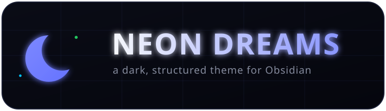
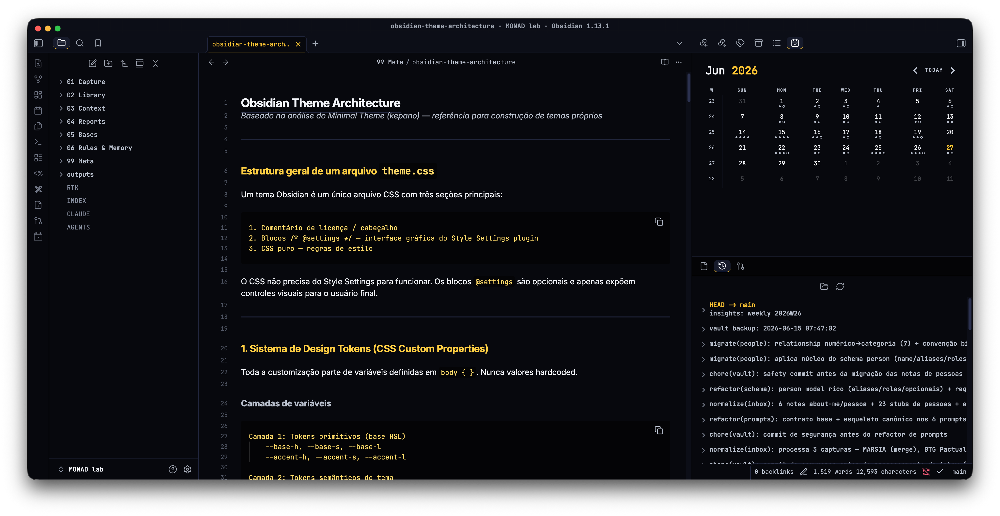
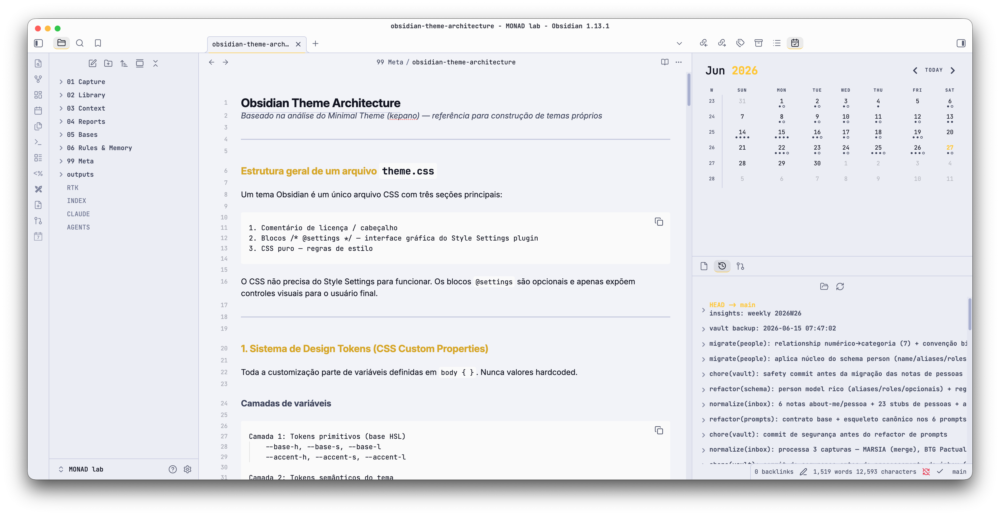
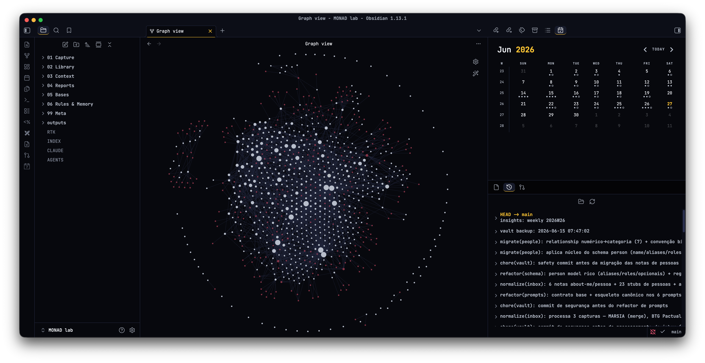
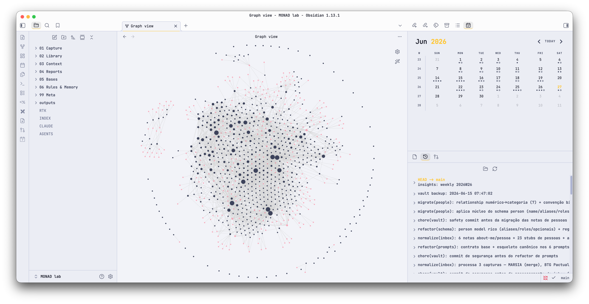

<h1 align="center">Neon Dreams</h1>
<h3 align="center">Personal theme for <a href="https://obsidian.md">Obsidian</a></h3> 

## Preface

A reading-first Obsidian theme with a precise, structured aesthetic, built for personal knowledge management, journaling, project tracking and markdown-based workflows. Charcoal backgrounds, cool neutral text, restrained separators and indigo for links, focus and selection.

Backgrounds and interactive accents use configurable HSL tokens. Headings remain neutral and semantic colors remain independent, so changing the accent does not turn every surface into a competing signal.

## Refactoring UI Refinement

Version 1.1.0 applies principles from *Refactoring UI*, its *Color Palettes*, *Component Gallery* and *Font Recommendations* to the existing Neon Dreams theme. It is an adaptation for Obsidian, not a copy of the gallery or an official Refactoring UI theme.

- **Hierarchy before decoration.** Neutral headings, distinct weights and more space before sections keep attention on the note. The workspace grid is now opt-in.
- **Readable supporting content.** Labels, placeholders, table headers and code comments use stronger contrast. Primary buttons use a darker fill than inline links to support white text.
- **Deliberate spacing.** A bounded 4/8/12/16/24/32px scale groups related controls and separates sections. Body line height is 1.65, while headings use tighter line heights.
- **Less visual framing.** Tables use horizontal separators, sentence-case sans-serif headers and tabular figures. Code blocks and blockquotes no longer carry decorative indigo borders.
- **Meaningful depth.** Menus, suggestions and dialogs have elevation shadows; everyday content stays flat.
- **Two complete modes.** Light mode uses darker semantic colors rather than putting dark-mode neon on white. Keyboard focus and reduced-motion preferences are respected.

Inter/system sans-serif remains the reading and interface stack. JetBrains Mono is reserved for code and tags; metadata and text-heavy tables no longer force a monospace face. Existing user font preferences still take precedence through Obsidian's native font variables.

Please note that I built this theme mostly for myself, so it may not fit every use case.

### If you like the theme

It is completely free, but if you want to throw a few coins in the hat, here is a link.  

## Screenshots

These screenshots show the previous release; they have not yet been recaptured in Obsidian for 1.1.0.

| Dark                                   | Light                                    |
| -------------------------------------- | ---------------------------------------- |
|  |  |
|    |    |

## Main Features

1. **HSL token system.** Change `--base-h` (background hue) and `--accent-h` (interactive accent hue) to adjust the neutral and accent scales. Text and semantic colors are calibrated separately. Contrast checks apply to the defaults, not every possible custom hue.
2. **Dark and light variants.** A near-black blue dark theme plus a light variant calculated from the same tokens.
3. **Style Settings integration.** Tweak colors and toggle behaviors without editing CSS (requires the [Style Settings](https://github.com/mgmeyers/obsidian-style-settings) plugin).
4. **Semantic callouts.** Left-border accent per type: cyan for info, green for success, amber for warning, red for danger, muted for quotes. An outlined variant is available.
5. **Task states.** Each `data-task` value gets a distinct checkbox icon and color, natively (no plugin required): `[ ]` todo, `[/]` in progress, `[>]` forwarded, `[?]` question, `[x]` done, `[-]` cancelled.
6. **Tag pills.** Tags render as rounded pills with an indigo tint. A plain text variant is available.
7. **Typography.** Inter/system sans-serif for prose, metadata and tables; JetBrains Mono for code and tags. The full heading scale (h1-h6) is configurable through size, weight, style and variant tokens.
8. **Quiet code blocks.** Recessed background, subtle outline and readable comments, with tinted inline code. Horizontal scroll is available.
9. **Readable tables.** Sans-serif headers, horizontal separators and tabular figures. Full-width and wide layouts are available; wide tables expand only on desktop in Reading view.
10. **Graph view and Canvas.** Nodes, tags, attachments and unresolved links follow the semantic palette. Canvas cards, edges and focus states use the accent.

## Additional Features

1. Optional grid overlay on the workspace (off by default).
2. Five-level text hierarchy that stays readable in grayscale.
3. Configurable readable line width, defaulting to `38rem`; enable Obsidian's Readable line length setting to use it.
4. Active line highlight (opt-in).
5. Hide markdown syntax in Live Preview (opt-in).
6. Minimal status bar and auto-hiding ribbon (opt-in).
7. Disable or speed up animations.

---

#### How to use the Style Settings plugin

1. Install the [Style Settings](https://github.com/mgmeyers/obsidian-style-settings) plugin, then enable it.
2. Go to Settings, then open the "Style Settings" tab.

From there you can:

- Set the base hue and saturation (background temperature).
- Set the accent hue and saturation (primary interactive color).
- Set readable line width (`28rem` to `48rem`).
- Enable the optional workspace grid.
- Enable/disable the active line highlight.
- Hide markdown syntax in Live Preview.
- Show/hide editor line numbers.
- Make code blocks scroll horizontally instead of wrapping.
- Hide the ribbon (show on hover).
- Use a minimal status bar (show on hover).
- Disable or speed up all animations.
- Use square checkboxes.
- Render tags as plain text.
- Use outlined, border-only callouts.
- Strip embed borders and titles.
- Use full-width or wide tables.

The line-number toggle styles the editor gutter; enable line numbers in Obsidian's Editor settings as well. CSS cannot create a gutter that the editor has not mounted.

---

## Recommended plugins

1. <a href="https://github.com/mgmeyers/obsidian-style-settings">Style Settings</a> (required for the visual controls above).

## Changelog

See [CHANGELOG.md](CHANGELOG.md).
